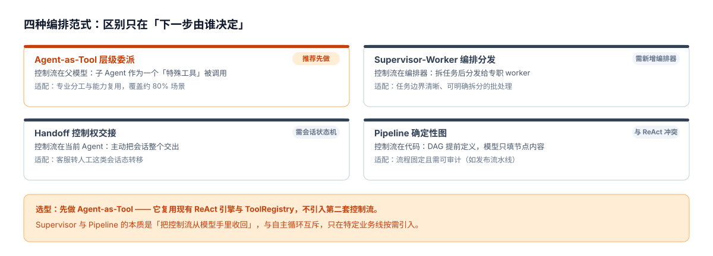
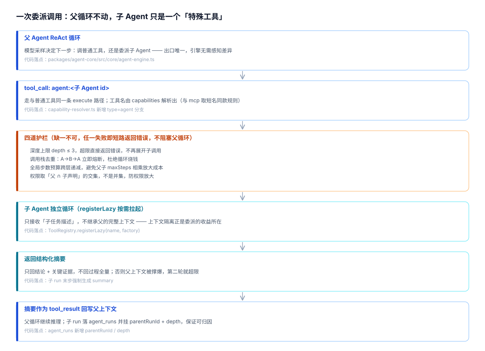

# 多 Agent 编排技术方案

> 状态：**待评审（设计稿，不含代码改动）** ｜ 日期：2026-10-13 ｜ 分支：`master`
> 视角：T11 架构师 —— 先定**范式**（控制流归谁），再定**链路**（引擎改哪里），最后才是**实现**。
> 配套图：`multi-agent-diagrams.html`（索引页）／`multi-agent-paradigms.svg`／`multi-agent-delegation-flow.svg`（均为生成物）
> 姊妹文档：`agent-system-design.md`（Agent 系统架构设计与缺口清单）、`ai-flow-technical-design.md`（AI 整体流程）
>
> 本文档只做设计与盘点，**不改任何代码**。落地时须按各自动作门执行（见 §9）。

---

## 0. 结论先行

**多 Agent 不是"更先进的架构"，而是"降低单个上下文熵"的手段。** 它同时放大调试难度与成本方差，因此先判断该不该上，再判断上哪种。

### 0.1 先答"要不要"：满足任一条件才考虑

| 信号 | 具体表现 | 说明 |
|---|---|---|
| **上下文污染** | 子任务的中间产物（原始检索结果、长文档全文）挤占主任务窗口 | 这是最硬的理由 —— 委派的本质收益就是隔离 |
| **能力复用** | 多个业务线需要同一项专业能力（如"合规检查"被几条线共用） | 抽取为子 Agent 后一处维护 |
| **并行提速** | 多个互不依赖的子任务可同时跑 | 只有此条需要真正的并发改造，成本最高 |

**三条都不满足时不要上。** 单 Agent + 更多工具通常已经够用，且省掉全部委派复杂度。

### 0.2 再答"上哪种"：选 Agent-as-Tool

| 结论 | 内容 |
|---|---|
| **范式** | Agent-as-Tool（层级委派）—— 子 Agent 作为一个「特殊工具」被父 Agent 调用 |
| **理由** | 复用现有 ReAct 引擎与工具注册中心，**不引入第二套控制流**；改动最小、可回退 |
| **不选 Supervisor** | 它把控制流从模型收回编排器，与 ReAct 自主循环互斥；仅在任务边界清晰且需强审计时引入 |
| **不选 Handoff** | 需要会话状态机与转移语义，面向"客服转人工"这类场景，与当前任务型 Agent 不匹配 |
| **不选 Pipeline** | 确定性 DAG 适合流程固定的场景（如发布流水线），不适合开放式任务 |

> 四者不是优劣关系，而是「**控制流放在谁手里**」的差异。模型手里 = 灵活但难预测；代码手里 = 可控但丧失自主性。当前系统以 ReAct 为范式，Agent-as-Tool 是唯一不冲突的扩展。

### 0.3 ⚠️ 依赖顺序（最重要的一条）

**先补 `agent_runs` 的业务结果归因，再上多 Agent。**

原本 `agent_runs` 只有 `status: 'ok' | 'error'`（技术状态：跑通与否），**没有业务结果维度**。单 Agent 时失败还能靠日志人工推断；多 Agent 之后，一次失败涉及多层子 run，"第几层第几步失败"在当前埋点下**完全不可见**。

顺序颠倒的后果：你会得到一堆无法归因的失败，且成本被放大数倍却说不清花在哪。

> **2026-10-20 B0 进度**：`outcome` / `fail_stage` / `graded_by` / `graded_at` 四列已实现于分支 `feat/agent-runs-outcome`（PR #368 draft），推导收口在 `AgentLogService.deriveAttribution`。
> ⚠️ **本条依赖尚未解除**：PR 未合入 master、迁移 `p36-agent-runs-outcome.mjs` 未执行、未部署 —— 线上 `agent_runs` 仍无 `outcome` 列可查。**三件事做完才算解锁**。
> ⚠️ 且 B0 只够"看到失败"：**归因到子 run 还需 P1 的 `parentRunId` / `depth` 落库**（见 §9）。

---

## 1. 四种编排范式



| 范式 | 控制流归属 | 适配场景 | 对当前系统的改动 |
|---|---|---|---|
| **Agent-as-Tool**（推荐） | 父模型 | 专业分工、能力复用 | 小 —— 复用现有引擎 |
| Supervisor-Worker | 编排器 | 任务可明确拆分 | 中 —— 需新增编排器 |
| Handoff | 当前 Agent | 会话态转移 | 大 —— 需会话状态机 |
| Pipeline | 代码 | 流程固定、需审计 | 中 —— 但与 ReAct 冲突 |

---

## 2. 选型论证：为什么是 Agent-as-Tool

### 2.1 现有代码已经留好了三条接缝

这不是从零开始 —— 现有架构中有三处天然接口，委派能力几乎可以"贴着"接上去：

| 接缝 | 位置 | 现状 | 多 Agent 怎么用 |
|---|---|---|---|
| 能力声明 | `packages/agent-core/src/interfaces/agent.interface.ts` | `CapabilityRef.type: 'tool' \| 'mcp' \| 'skill'` | 加第四类 `'agent'`，ref = 子 Agent id |
| 工具注册 | `packages/agent-core/src/registry/tool.registry.ts` | 已有 `registerLazy(name, factory)` 懒加载 | 子 Agent 注册为 lazy 工具 —— **不调不拉起** |
| 能力解析 | `packages/agent-core/src/core/capability-resolver.ts` | 把能力声明归一为引擎可消费结构 | 多解析一类即可；无 `capabilities` 时保持旧字段回退 |

**关键含义**：多 Agent 在本系统里不是新子系统，而是"**能力类型的第四种取值**"。这是当前耦合成本最低的落地路径。

### 2.2 为什么复用 `registerLazy` 而不是新写注册表

`registerLazy` 的设计动机就是"MCP 等远程工具按需拉起"。子 Agent 与远程工具形态高度相似 —— 都是**首次调用时才需要付出实例化成本**。复用现成机制可以避免：

- 启动时全量展开所有子 Agent 定义（浪费，且随 agent 数量线性增长）
- 引入第二套生命周期管理（重复造轮子）

### 2.3 与"给父 Agent 多挂几个工具"的区别

有人会问：既然工具已能扩展，为什么不把子 Agent 的能力直接拆成工具挂给父 Agent？

| 维度 | 拆成工具挂给父 | 子 Agent |
|---|---|---|
| 上下文 | 工具结果全量进父窗口 | 子 Agent 内部消化，只回摘要 |
| 推理 | 父模型自己多步推理 | 子 Agent 有自己的 systemPrompt 与步数预算 |
| 复用 | 工具是单步能力 | 可承载一个完整专业流程 |
| 适用 | 单步、无状态、结果短 | 多步、有专业上下文、结果需提炼 |

结论：**工具是"动作"，子 Agent 是"带上下文的动作"**。当动作需要自己的推理循环与专业提示词时，才值得升级为子 Agent。

---

## 3. 调用链路设计



> 本图 = **主链路图** `ai-agent-run-flow.svg` 中「递归层」（第 12–15 段，青色虚线框）的放大；主链路图已把多 Agent 画进「完整链路」——单 Agent 运行整段跳过，只有工具解析为子 Agent 时才进入。

一次委派 = 父循环中的一个工具调用，全链路阶段：

| # | 阶段 | 关键点 | 代码落点 |
|---|---|---|---|
| 1 | 父 Agent ReAct 循环 | 模型采样决定"调普通工具 or 委派子 Agent"，出口唯一 | `core/agent-engine.ts` |
| 2 | `tool_call: agent:<id>` | 与普通工具同一 execute 路径，引擎几乎不用改 | `capability-resolver.ts` 新增分支 |
| 3 | **四道护栏** | 深度 / 循环 / 预算 / 权限，任一失败即短路返回错误 | 新增（见 §5） |
| 4 | 子 Agent 独立循环 | 只接收子任务描述，不继承父的完整上下文 | `ToolRegistry.registerLazy` |
| 5 | 返回结构化摘要 | 只回结论 + 关键证据，不回过程全量 | 子 run 末步生成 summary |
| 6 | 回写父上下文 | 作为 tool_result 进入父 messages，父继续推理 | 与普通工具结果同路径 |

**"引擎几乎不用改"的含义**：子 Agent 复用了工具调用的全部既有机制（schema 注入、结果回写、步骤落 `agent_runs.steps`）。真正需要新增的只有**中间那道护栏**与**子 run 的父子关联**。

---

## 4. 数据契约（三处扩展，向后兼容）

### 4.1 `CapabilityRef` —— 新增 `agent` 类型

```ts
// packages/agent-core/src/interfaces/agent.interface.ts
export interface CapabilityRef {
  type: 'tool' | 'mcp' | 'skill' | 'agent';   // ← 新增 'agent'
  ref: string;                                 // agent: 子 Agent id
  enabled: boolean;
  config?: Record<string, unknown>;            // agent: 可覆盖 maxSteps / 超时
}
```

**兼容性**：`capabilities` 是 JSON 列（`agent_definitions.capabilities`），新增枚举取值**不动表结构、无 DDL**。存量数据不含 `'agent'`，解析逻辑自然跳过。

### 4.2 `ToolContext` —— 新增委派上下文

```ts
// packages/agent-core/src/interfaces/tool.interface.ts
export interface ToolContext {
  userId: string;
  runId: string;
  deps: Record<string, unknown>;
  confirm?(message: string): Promise<boolean>;   // 已有：危险操作确认
  // ── 新增（仅委派调用时填充）──
  depth?: number;                                  // 当前嵌套深度，顶层 = 0
  callStack?: string[];                            // 已展开的 agent id 栈，用于循环检测
  stepBudget?: { used: number; total: number };    // 跨层共享的步数预算
}
```

全部可选字段 → **对现有工具零影响**（普通工具不读这几个字段）。

### 4.3 `agent_runs` —— 分两批加列

现有字段已足够支撑"技术状态"：`status: 'ok' | 'error'`、`durationMs`、`cost`、`totalTokens`、`steps`（JSON 流水）。

| 批次 | 新增列 | 用途 | 归属 |
|---|---|---|---|
| **第一批（P0，先做）** ✅ | `outcome` | 业务结果：success / partial / fail | 质量归因（见 §8）—— B0 2026-10-20 已实现（PR #368 draft；`p36` 迁移待执行） |
| | `failStage` | 失败环节标记 | 质量归因 |
| | `parentRunId` | 子 run 指向父 run | 多 Agent 可观测 |
| | `depth` | 嵌套深度 | 多 Agent 可观测 |
| 第二批（P2） | `gradedBy` | 结果由谁判定（人工 / LLM-judge / 规则） | 评测体系 |

> ⚠️ `parentRunId` / `depth` 是**多 Agent 可观测的地基**：没有它们，一次失败无法定位到具体子 run。

### 4.4 兼容性总原则

| 扩展点 | 兼容策略 | 存量影响 |
|---|---|---|
| `CapabilityRef.type` | JSON 列内新增枚举值 | 无 DDL、无影响 |
| `ToolContext` | 全字段可选 | 现有工具不读，无影响 |
| `agent_runs` 新列 | 全部 nullable | 存量 run 行为不变（回归对照） |

---

## 5. 四道护栏（必须，不是可选项）

多 Agent 的风险集中在"递归 + 成本 + 权限"三个方向。以下四道护栏缺一不可：

| # | 护栏 | 规则 | 缺失后果 |
|---|---|---|---|
| 1 | **深度上限** | `depth ≤ 3`，超限直接返回错误 | 无限递归，栈深不可控 |
| 2 | **循环检测** | `callStack` 去重：A→B→A 立即熔断 | 死循环烧钱直到超时 |
| 3 | **步数预算** | 跨层**共享**递减，不是各层独立 `maxSteps` | 父 10 步 × 子 10 步 = 100 次模型调用 |
| 4 | **权限收敛** | 子可用工具 = **父 ∩ 子声明**（交集） | 子 Agent 越权调用高权限工具 |

**失败语义**：任一护栏触发 → **短路返回结构化错误**（`ToolResult.success = false`），**不阻塞父循环**。父模型可据此选择重试、换路径或直接回答 —— 这与现有工具失败的降级路径一致。

> 第 3 条的"共享递减"是最容易被忽略的一条。各层独立配 `maxSteps` 时，总调用次数是**乘积**而不是和 —— 这是成本失控最常见的来源。

---

## 6. 六个预计会踩的坑

| 坑 | 现象 | 对策 |
|---|---|---|
| 循环调用 A→B→A | 死循环，直到超时 | 护栏 1 + 2（`callStack` 去重） |
| 预算乘积 | 一次请求模型调用次数暴涨 | 护栏 3（跨层共享预算） |
| 上下文膨胀 | 子 Agent 返回过程全量 → 父窗口被撑爆 | 子 Agent 末步**强制生成摘要** |
| 权限放大 | 子 Agent 越权 | 护栏 4（交集，非并集） |
| 错误传播 | 父拿到空结果继续编造 | 子返回结构化 `ToolResult`（带 error code） |
| 可观测黑洞 | 只知道父失败，不知哪层哪步 | 子 run 落库带 `parentRunId` + `depth` |

---

## 7. 可观测性

### 7.1 落库

子 Agent run 复用现有 `agent_runs` 表（`servers/ai-service/src/agent-log/entities/agent-run.entity.ts`），新增 `parentRunId` / `depth` 后即可重建调用树。`source` 字段已可区分来源服务。

### 7.2 前端事件

建议在现有 SSE 事件流中新增两个事件（与既有 `tool_call` / `tool_result` 同级）：

| 事件 | 携带内容 | 用途 |
|---|---|---|
| `sub_agent_start` | 父 runId、子 agentId、depth、子任务描述 | 前端显示"正在委派给 XX" |
| `sub_agent_end` | 子 runId、结果摘要、耗时、是否触发护栏 | 前端展示委派结果与失败原因 |

**是否复用 `tool_*` 事件**：可复用（对前端零改造），但会丢失"这是委派"的语义。建议新增，便于后续在 UI 上区分"调工具"与"派子 Agent"。

---

## 8. 与质量归因的依赖顺序

```
P0  agent_runs 加 outcome / fail_stage          ← 必须先做
    └ 2026-10-20：代码已实现（PR #368 draft），剩「合入 + p36 迁移 + 部署」三件事
        │
        ▼
P1  多 Agent 内核 + parentRunId / depth          ← 依赖上方，才能归因到子 run
        │
        ▼
P2  评测体系（golden 集 + LLM-as-judge）         ← 依赖 outcome 才有判据
```

**为什么不能颠倒**：多 Agent 的价值之一是"专业分工提升质量"，但**质量是否提升需要 `outcome` 才能度量**。先上多 Agent，等于在没有仪表盘的情况下改发动机。

---

## 9. 分阶段实施与验收

| 阶段 | 内容 | 工作量 | 动作门 |
|---|---|---|---|
| **P0** ✅ | `agent_runs` 加 `outcome` / `fail_stage` + 阶段埋点 —— **代码已实现**（PR #368 draft）；剩合入 master + 执行 `p36` 迁移 + 部署 | 1.5d | **契约门** |
| **P1** | 多 Agent 内核：`capabilities` agent 类型 + 子 Agent 工具 + 四道护栏 | 1.5d | **契约门**（动 agent-core） |
| **P1** | 可观测：`parentRunId` / `depth` 落库 + SSE 事件 | 1d | 契约门 |
| **P2** | admin 能力选择器新增「子 Agent」类型 | 0.5d | **UI 门** |
| P3 | 并行委派（多子 Agent 同时跑） | 2d | 契约门 —— 仅在有明确并行需求时做 |

### 验收标准

1. **零回归**：存量 agent 行为与改动前完全一致（不声明 `agent` 能力即完全不进新路径）。
2. **护栏有效**：构造 A→B→A 循环用例，验证在 depth ≤ 3 内熔断且返回结构化错误。
3. **预算可控**：一次含委派的请求，模型调用总次数 ≤ 配置的全局预算（非乘积）。
4. **可归因**：一次失败的子 Agent 调用，能从 `agent_runs` 定位到 `parentRunId` + `depth` + `fail_stage`。（`fail_stage` 侧由 B0 提供，`parentRunId` / `depth` 属 P1，尚未落库）
5. **上下文隔离**：子 Agent 输入不含父的完整对话历史（仅子任务描述 + 必要引用）。
6. **权限不放大**：子 Agent 声明的工具超出父权限时，实际可用为交集。

---

## 10. 关联文档

| 文档 | 用途 |
|---|---|
| `agent-system-design.md` | Agent 系统架构设计（8 维度 / 4 层）+ 缺口清单 P0→P2 |
| `ai-flow-technical-design.md` | AI 整体流程（主链路 / SSE 事件 / 容错矩阵） |
| `ai-flow-diagrams.html` | AI 子系统架构图 + Agent 运行主链路 + 知识链路 |
| `kedou-architecture-diagrams.html` | 业务架构图 + 技术架构图 |
| `multi-agent-diagrams.html` | 本文配套图（四范式对比 + 委派调用链） |

> 图的生成脚本：`scripts/gen-multi-agent-diagrams.mjs`。改图请改脚本内数据后重跑，**不要手改 SVG / 索引页**。
