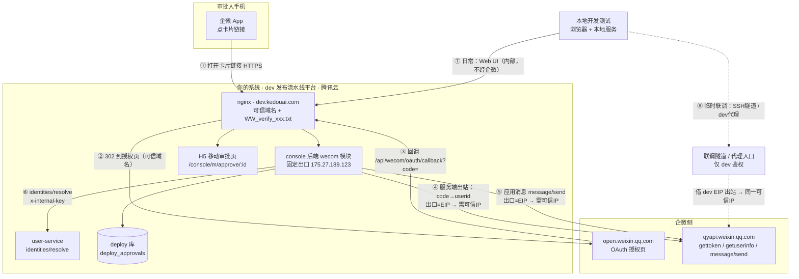
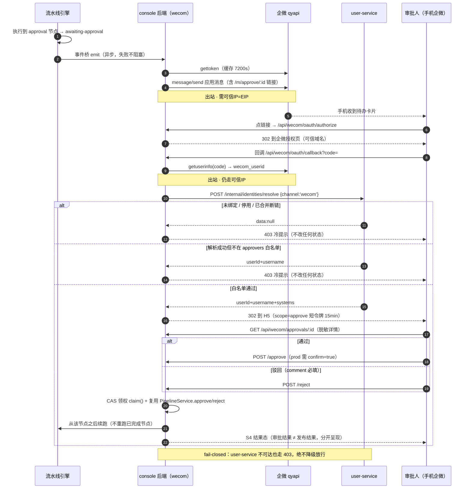
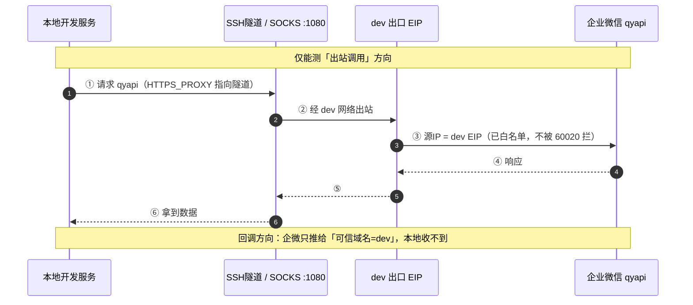
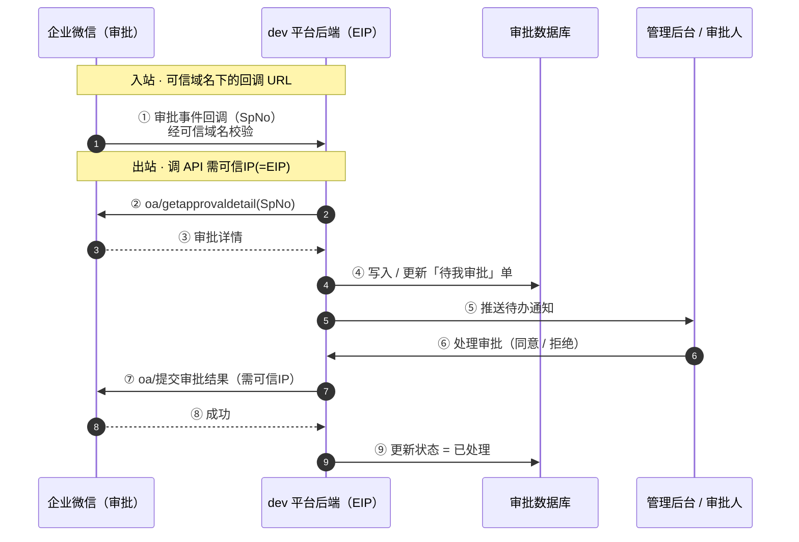

# 企微审批集成 · 网络流程图 + 时序图

> 状态：实施中 ｜ 2026-11-06
> 开关：CHANGELOG=off · HISTORY_NOTE=off · FAQ_KEEP=on
> 定位：deploy-console 企微审批特性的**网络拓扑与运行时序**（配 [`design.md`](./design.md) §5.1 链路图读）。

> 配套：[`design.md`](./design.md)（需求与方案）、[`docs/development/wecom-api-trusted-ip.md`](../../docs/development/wecom-api-trusted-ip.md)（出站安全规范）
> 角色：dev（发布流水线平台）= 正式运行后端，唯一长期直连企微；本地 = 开发测试，日常只走 Web UI。

---

## 〇、先纠偏：可信域名 ≠ 可信IP

| 机制 | 管的是哪一侧 | 解决什么 | 能否替代对方 |
|---|---|---|---|
| **可信域名** | **入站**（企微 / 浏览器主动找你） | 网页授权回调、JS-SDK 安全域名、接收消息服务器 URL 归属校验 | ❌ 管不了"你调企微 API" |
| **可信IP** | **出站**（你的服务器用 secret 调企微） | 限制"谁能拿这个应用 secret 调接口"的来源 IP | ❌ 管不了回调 / 网页授权 |

**结论**：「用可信域名 + 接口免掉 IP 加白」不成立 —— 两者管的是相反方向。能做的优化是**把出站收敛成一个固定 EIP，让白名单永不需要维护**。

**角色定位**：

- **dev（发布流水线平台）= 正式运行后端，唯一长期直连企微**；
- **本地 = 开发测试用，日常操作只走 Web UI；临时联调经隧道 / 代理借 dev EIP**，不必把本地动态 IP 加白；
- 白名单只需覆盖 **dev 平台的固定出口 IP 一个**（`175.27.189.123`）。

---

## 一、网络流程图（B 方案真实链路）

**连接说明**

| 编号 | 方向 | 通道 | 安全机制 | 是否长期 |
|---|---|---|---|---|
| ① | 手机企微 → dev | 打开卡片链接（HTTPS） | 自有 H5 + scope=approve 短令牌 | 长期 |
| ②③ | 企微 ↔ dev | OAuth 网页授权 / 回调 | **可信域名** `dev.kedouai.com` | 长期 |
| ④⑤ | dev 平台 → 企微 | 服务端调 `qyapi`（换 userid、发应用消息） | **可信IP = EIP** `175.27.189.123` | 长期 |
| ⑥ | console → user-service | 内部 HTTP（`x-internal-key`） | 内网 + key | 长期 |
| ⑦ | 本地 → dev | 内部 Web UI | 自有鉴权 | 日常 |
| ⑧ | 本地 → 企微（临时） | SSH 隧道 / dev 代理借道 | 复用 **dev EIP**，本地 IP 不加白 | 临时、可选 |

> 🔴 **④ 是唯一容易被忽略的出站**：OAuth 免登看起来"只是浏览器跳转"，但 `code → userid` 换取的 `getuserinfo` 是**服务端出站调用**，同样受可信IP 约束。

---

## 二、主时序图（稳态主链路：挂起 → 推送 → 免登 → 审批 → 续跑）

---

## 三、本地临时联调时序图（为何不塞进主图）

主时序图只画**稳态**（dev ↔ 企微）；本地属于**可选拓扑通道**，塞进主时序会把"运行时主链路"和"开发期借道"混为一谈。所以：**拓扑图含本地（它画的是连接），时序图拆两张（稳态 / 本地联调），各司其职。**

> 🔴 **关键限制**：本地经隧道只能测**出站调用**（gettoken / getuserinfo / message/send）；**OAuth 回调方向收不到**——回调地址必须是可信域名指向的 dev。要在本地验回调逻辑，用 **mock 回调参数**，或直接到 dev 环境联调。

---

## 四、本地临时联调：四种方式取舍

| 方式 | 怎么做 | 企微看到的出口 IP | 便利度 | 前提 / 代价 | 建议 |
|---|---|---|---|---|---|
| **SSH 隧道 / SOCKS 代理** | `ssh -D 1080 -N dev-host`，本地服务 `HTTPS_PROXY=socks5://127.0.0.1:1080` | **dev EIP（已白名单）** | 高，不改企微配置 | 需 dev SSH 权限；只联调时开 | ✅ **首选** |
| **dev 联调代理接口** | dev 暴露受鉴权的 `/internal/wecom-proxy/*`，本地调它转发 | **dev EIP** | 高，团队统一 | 要开发/维护代理接口 + 鉴权 | ✅ 团队化首选 |
| **本地 mock** | nock / msw / fixture 假响应，不打真企微 | 无 | 最高 | 只验逻辑，不验真链路 | ✅ 单测/集成测默认 |
| **临时加白本地公网 IP** | 查本地当前公网 IP，临时加进「企业可信IP」，用完删 | 本地动态 IP | 即时 | 动态 IP 易变、无过期、审计债 | ⚠️ 仅应急、短期 |

**推荐组合**：单测/集成测用 **mock**；真链路冒烟用 **SSH 隧道 / dev 代理**（本地免加白、出口仍是 dev EIP）；只在极端应急时才"临时加白本地 IP"，且**用完立刻删**。

---

## 五、落地建议（按优先级）

| 优先级 | 动作 | 解决什么 |
|---|---|---|
| P0 | dev 平台调用机绑 **EIP** 或走 **NAT 网关固定出口**，把该 IP 填进应用「企业可信IP」 | 动态 IP 痛点彻底消失，白名单只一个、永不变 |
| P0 | 本地**日常只走 Web UI**；临时联调走 **SSH 隧道 / dev 代理**借 dev EIP | 本地动态 IP 不必加白 |
| P1 | 提供 **dev 联调代理 / 隧道入口**（受鉴权），作为团队统一临时通道 | 便利与安全兼得 |
| P1 | **dev 即正式平台**：白名单 = dev 固定 EIP（一个即可）；仅当未来另起独立 prod 才需分离应用与白名单 | 当前无需 dev/prod 拆分 |
| P2 | 给推送链路加**失败告警**，防 60020 静默吞待办 | 可观测 |
| P2 | 季度审计可信IP 白名单，清 stale；临时加白的本地 IP 必删 | 降审计债 |

---

## 六、未来参考：若接企微 OA 审批（`oa/*`，**本期不做**）

> 本节**不属于本期范围**。设计见 [`design.md`](./design.md) §3.3 非目标 + 方案 C（L 档）。
> 保留它的原因是：将来真要做"拉取企微审批待办"时，出站约束和网络拓扑与本方案完全一致，可直接复用下面这张时序。
> ⚠️ **不要**把这张图当作当前实现——当前实现是「应用消息 + OAuth H5」，不调 `oa/*`。

> 即使走回调，事件体通常只带 `SpNo`，**拉详情那一次 `oa/getapprovaldetail` 仍是出站 API 调用，仍要走可信IP**。回调只是把"全量轮询"降为"按事件拉详情"。

---

## 七、一句话记住

> **可信域名管"企微来找你"，可信IP 管"你去找企微"。** 稳态只 dev 平台直连、白名单只一个固定 EIP；本地临时联调走隧道 / 代理"借"这个 EIP，**永不把动态本地 IP 写进企微白名单**。
